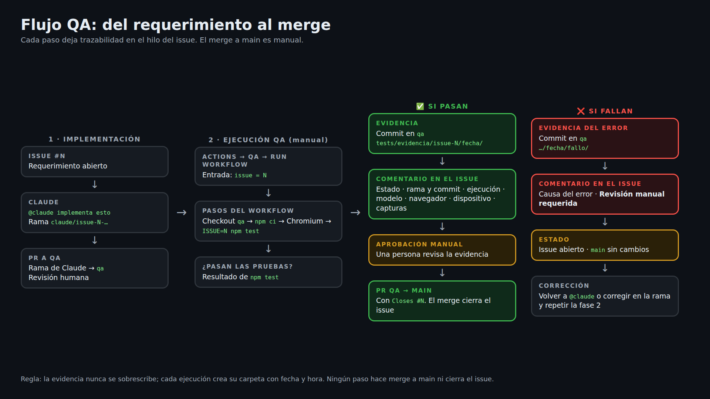

# Flujo QA

Cada requerimiento pasa por la rama `qa` antes de llegar a `main`. Las pruebas corren con Playwright, la evidencia queda en el repositorio y en el hilo del issue, y el merge a `main` lo aprueba una persona.

## Resumen de pasos

1. Claude implementa el requerimiento en su rama `claude/issue-N-…`.
2. Esa rama se une a `qa` mediante una PR.
3. Se lanza el workflow **QA** (Actions → QA → Run workflow) con `issue = N`.
4. Si las pruebas pasan, el comentario del issue incluye la evidencia, el modelo, el navegador y el dispositivo. Una persona aprueba la PR de `qa` a `main`.
5. Si fallan, el comentario indica la causa y marca revisión manual. El issue sigue abierto y `main` no cambia.

La evidencia se guarda en `tests/evidencia/issue-N/AAAA-MM-DD_HH-MM-SS/`. Cada ejecución crea su propia carpeta, y los errores quedan en `fallo/`.

## Documentación detallada
Las fases, los ciclos y el uso de Claude están en [docs/qa/index.md](qa/index.md).
