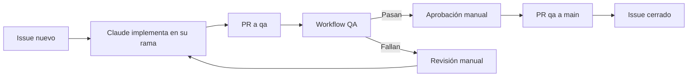

# Ciclo de vida de un requerimiento

Hay tres ciclos. Todos pasan por `qa` antes de llegar a `main`.

## 1. Requerimiento nuevo
Un issue pide algo nuevo, por ejemplo el modo claro.

## 2. Solicitud
Una persona pide un cambio de documentación o de configuración. Se hace con una PR directa, sin issue.

## 3. Corrección de error
Algo falla en `qa`. El issue sigue abierto hasta que las pruebas pasan.

Consulta cada paso en [las fases de QA](index.md).
