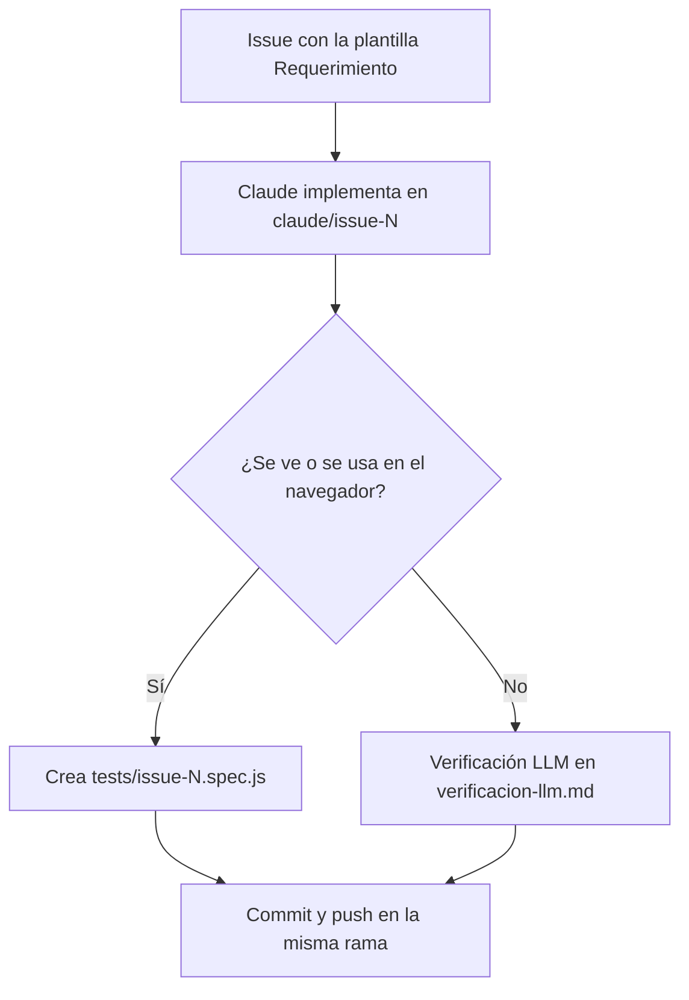

# Fase 1 · Implementación y decisión de evidencia

**Qué pasa:** se crea el issue con la plantilla **Requerimiento**. Como la plantilla menciona a `@claude`, Claude empieza en cuanto se abre el issue.

**Quién:** Claude, siguiendo la skill `qa-tests`.

**Pasos de Claude:**
1. Implementa lo solicitado en su rama `claude/issue-N-…`.
2. Decide qué evidencia corresponde y explica el motivo en su comentario:
   - **Automatizar:** el cambio se ve o se usa en el navegador (interfaz, teclas, puntaje, estados). Crea `tests/issue-N.spec.js` con un escenario por criterio.
   - **Verificación LLM:** el cambio no se ve en el navegador (documentación, configuración, workflows). Revisa cada criterio contra el cambio y lo deja en `tests/evidencia/issue-N/verificacion-llm.md`.
   - Si duda, automatiza.
3. Hace commit y push de todo en la misma rama.

**Resultado:** una rama con el cambio y su evidencia, y un comentario con la decisión tomada.

**Siguiente paso:** una persona une la rama a `qa` con una PR → [Fase 2 · Ejecución de pruebas](fase-2-ejecucion.md).
