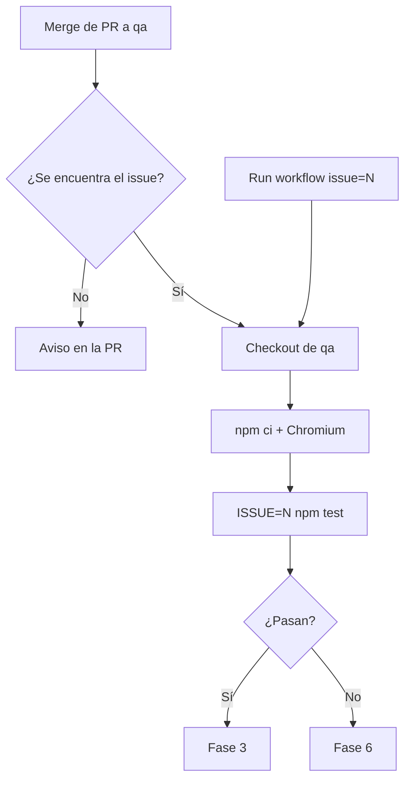

# Fase 2 · Ejecución de pruebas

**Qué pasa:** la rama de Claude se une a `qa` y se ejecutan las pruebas automatizadas.

**Cómo se lanza:**
- **Automático:** al hacer merge de una PR hacia `qa`. El número del issue sale del nombre de la rama (`claude/issue-N-…`) o de `Refs #N` en la descripción de la PR. Si no lo encuentra, deja un aviso en la PR y no ejecuta las pruebas.
- **Manual:** Actions → QA → Run workflow → `issue = N`. Sirve para relanzar.

**Qué hace el workflow:**
1. Toma la rama `qa`.
2. Instala dependencias (`npm ci`) y Chromium.
3. Ejecuta `ISSUE=N npm test`.

**Siguiente paso:** [Fase 3 · Evidencia](fase-3-evidencia.md) si pasan, o [Fase 6](fase-6-fallo.md) si fallan.
