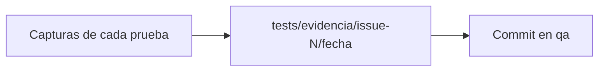

# Fase 3 · Evidencia

**Qué pasa:** se guardan las capturas de cada prueba y se registran en `qa`.

**Dónde queda:** `tests/evidencia/issue-N/AAAA-MM-DD_HH-MM-SS/`

**Reglas:**
- Cada ejecución crea su propia carpeta.
- Nunca se sobrescribe una ejecución anterior.
- Se hace commit en `qa` con el mensaje `Evidencia QA del issue #N`.

**Siguiente paso:** [Fase 4 · Comentario en el issue](fase-4-comentario.md).
