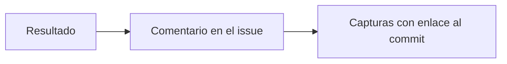

# Fase 4 · Comentario en el issue

**Qué pasa:** el workflow publica un comentario en el issue con el resultado.

**Qué incluye:**
- Estado: pasan o fallan.
- Rama y commit de `qa`.
- Carpeta de la ejecución.
- Modelo configurado.
- Navegador y versión.
- Dispositivo y viewport.
- Capturas.

**Siguiente paso:** [Fase 5 · Aprobación y merge](fase-5-aprobacion.md).
