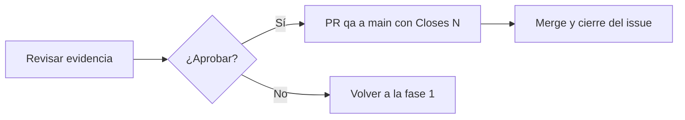

# Fase 5 · Aprobación y merge

**Qué pasa:** una persona revisa la evidencia y decide si `qa` pasa a `main`.

**Reglas:**
- El merge es manual. Ningún workflow lo hace.
- La PR de `qa` a `main` incluye `Closes #N`. Al fusionarla, el issue se cierra.

**Siguiente paso:** si se aprueba, el ciclo termina. Si no, vuelve a [Fase 1](fase-1-implementacion.md).
