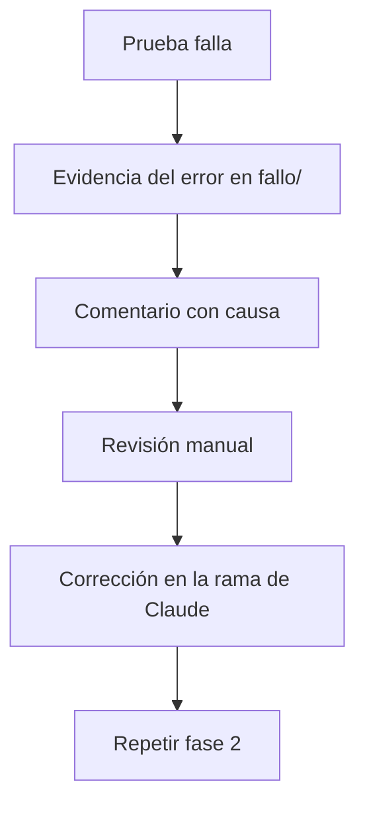

# Fase 6 · Fallo y revisión manual

**Qué pasa:** una prueba falla. Nada llega a `main`.

**Qué queda registrado:**
- Carpeta `fallo/` con la captura y el contexto del error.
- Comentario en el issue con la causa y la marca **Revisión manual requerida**.

**Qué no pasa:**
- El issue sigue abierto.
- `main` no cambia.

**Siguiente paso:** [Fase 2](fase-2-ejecucion.md), después de corregir.
