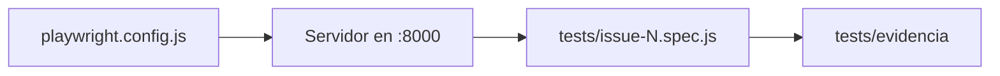

# Framework de pruebas

**Herramienta:** Playwright (`@playwright/test` 1.64.1, versión fija).

**Dónde está:**
- `tests/issue-N.spec.js`: las pruebas, un archivo por issue. Las del modo claro están en `tests/issue-3.spec.js`.
- `tests/helpers/evidencia.js`: la función `capturar`, compartida por todas las pruebas.
- `tests/evidencia/`: las capturas por issue y fecha.
- `playwright.config.js`: servidor local en el puerto 8000 y tema oscuro fijo.

**Comandos:**
- `npm ci`: instalar dependencias.
- `npx playwright install chromium`: instalar el navegador.
- `ISSUE=N npm test`: ejecutar las pruebas de un issue.

**Reglas importantes:**
- El tema depende de la preferencia del sistema. Por eso la configuración fija `colorScheme: 'dark'`.
- Cada ejecución corre todas las pruebas (regresión), pero solo guarda capturas de `tests/issue-N.spec.js` del issue en curso.
- `playwright.config.js` fija una sola fecha y hora por ejecución (`EVIDENCIA_STAMP`). Así todas las capturas quedan en la misma carpeta aunque las pruebas corran en paralelo.

Más detalle del proceso: [Claude como asistente de pruebas](pruebas-con-claude.md).
