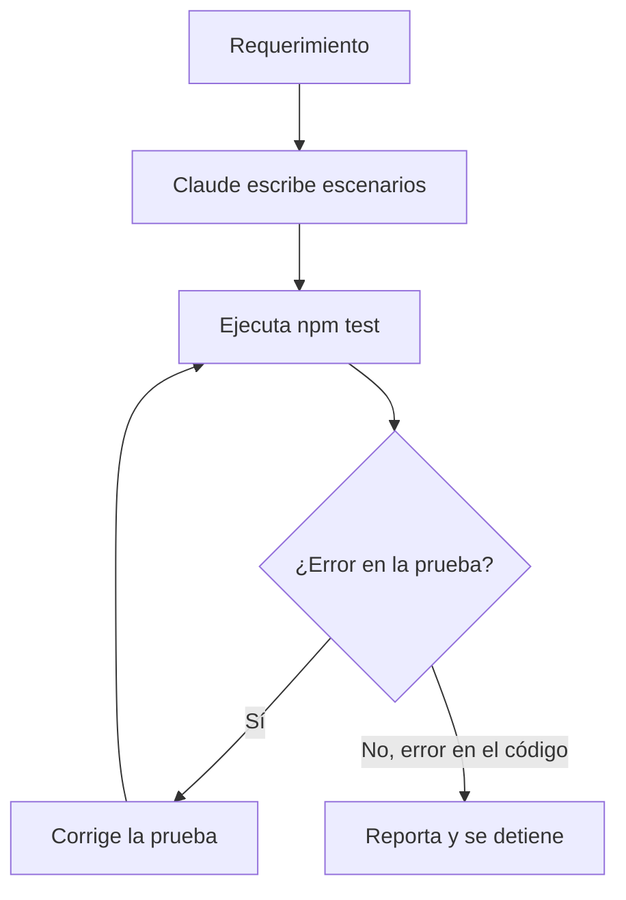

# Claude como asistente de pruebas

Claude puede escribir las pruebas de un requerimiento siguiendo la skill del proyecto.

**Decide el tipo de evidencia:** después de implementar, Claude decide si el cambio necesita pruebas automatizadas o una verificación LLM, y explica el motivo en su comentario. Ver [Fase 1](fase-1-implementacion.md).

- **Pruebas automatizadas:** se ejecutan en el workflow QA y dejan capturas.
- **Verificación LLM:** una revisión rápida de cada criterio contra el cambio. No ejecuta nada, así que no reemplaza una prueba; sirve para cambios que no se ven en el navegador.

**Qué hace Claude:**
1. Lee el requerimiento y lo convierte en escenarios.
2. Escribe las pruebas en `tests/`.
3. Ejecuta `ISSUE=N npm test` y revisa el resultado.
4. Si el error está en la prueba, la corrige. Si está en el código, lo reporta y se detiene.

**Qué no hace Claude:**
- No hace merge a `main`.
- No borra pruebas para que el resultado sea verde.
- No modifica el código de la aplicación para que una prueba pase.

**Dónde se define:** `.claude/skills/qa-tests/SKILL.md`.

Ver también: [Framework de pruebas](framework-pruebas.md).
