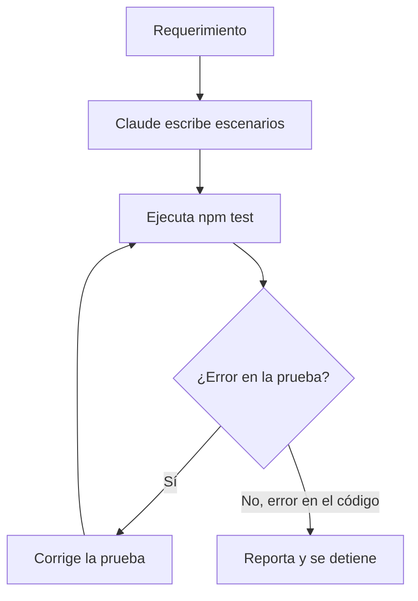

# Claude como asistente de pruebas

Claude puede escribir las pruebas de un requerimiento siguiendo la skill del proyecto.

**Qué hace Claude:**
1. Lee el requerimiento y lo convierte en escenarios.
2. Escribe las pruebas en `tests/`.
3. Ejecuta `ISSUE=N npm test` y revisa el resultado.
4. Si el error está en la prueba, la corrige. Si está en el código, lo reporta y se detiene.

**Qué no hace Claude:**
- No hace merge a `main`.
- No borra pruebas para que el resultado sea verde.
- No modifica el código de la aplicación para que una prueba pase.

**Dónde se define:** `.claude/skills/qa-tests/SKILL.md`.

Ver también: [Framework de pruebas](framework-pruebas.md).

## Consumo de tokens

Solo dos workflows usan el modelo. El workflow QA no usa Claude.

| Workflow | Cuándo gasta tokens | Límites |
|---|---|---|
| `claude.yml` | Solo cuando alguien escribe `@claude` | Modelo de `.claude/settings.json`, **presupuesto de 40 turnos por issue** (suma de todas las ejecuciones), sin los comentarios de `github-actions[bot]` en el contexto |
| `claude-code-review.yml` | Al abrir una PR con cambios de código | Mismo modelo, máximo 15 turnos. No corre en cada push, ni en PRs de `qa` a `main`, ni en borradores, ni si solo cambian evidencia, docs o imágenes |

Para revisar de nuevo una PR después de cambios, comentar `@claude revisa esta PR`.

### Presupuesto de turnos por issue
- Después de cada ejecución, el comentario `🔎 Modelo usado…` muestra `Turnos usados en este issue: X de 40`.
- Cada ejecución solo puede usar los turnos que quedan.
- Si no quedan, Claude no se ejecuta y aparece **"⛔ Claude se quedó sin intentos en este issue"**, con los pasos para validar a mano: la rama, cómo abrir el juego, los criterios del issue y cómo correr las pruebas.
- Para dar más margen, se cambia `LIMITE_TURNOS` en `.github/workflows/claude.yml`, o se abre un issue nuevo con lo que falte.
