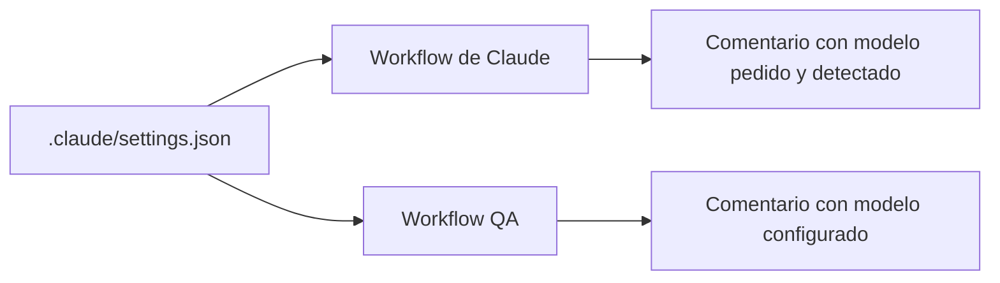

# Trazabilidad del modelo

Cada ejecución deja registrado qué modelo se usó.

**Fuente:** `.claude/settings.json`, campo `model`.

**Dónde se ve:**
- En el comentario de la ejecución de Claude: `🔎 Modelo usado en esta ejecución`, con el modelo pedido y el detectado.
- En el comentario de QA: `Modelo configurado`.

**Cómo se cambia:** se edita `.claude/settings.json`, se hace commit y push a `main`. Queda en el historial.

**Límite:** el modelo detectado viene del registro de la sesión. No es una confirmación directa de Anthropic.
